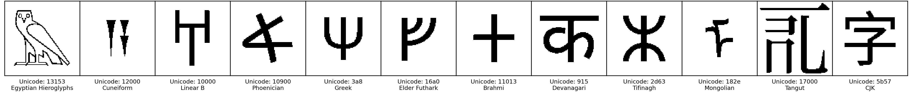
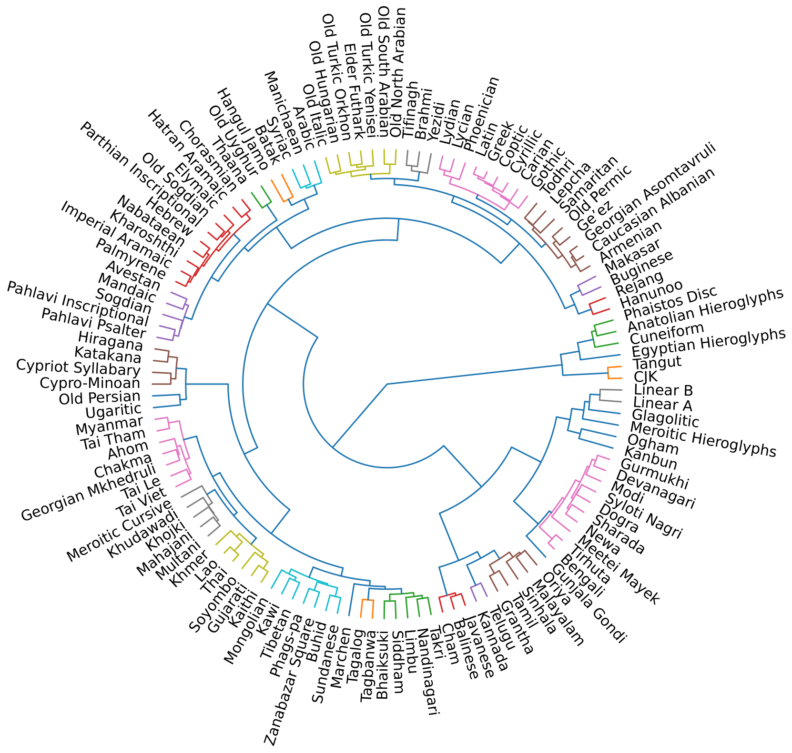
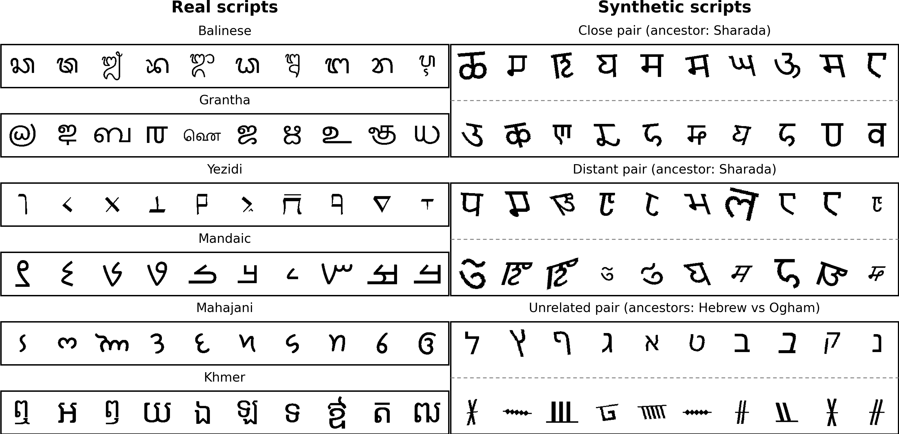
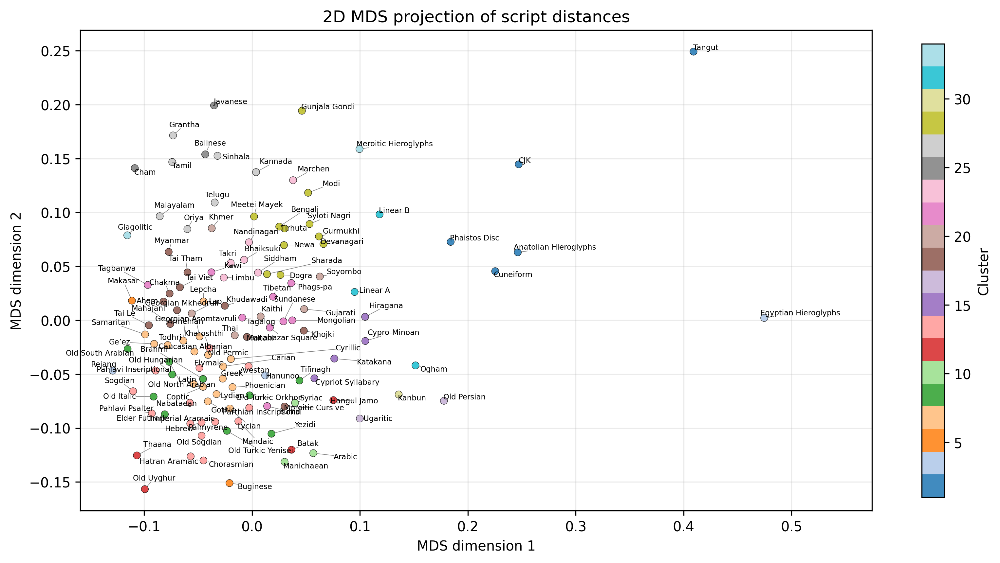

# A Quantitative Visual Taxonomy of Worldwide Writing Systems

<p align="center">
  
</p>

## About
This repository includes the code associated with the paper **A Quantitative
Visual Taxonomy of Worldwide Writing Systems**, accepted at the
[40th Conference on Neural Information Processing Systems (NeurIPS 2026)](https://neurips.cc/Conferences/2026).

Here is the abstract of the article:
*Quantitatively comparing writing systems at a worldwide scale is challenging because visual similarity must be inferred without relying on predefined linguistic or genealogical assumptions, and only limited ground-truth taxonomy is available for validation. We introduce a fully data-driven framework for comparing scripts based on learned glyph representations. Using a teacher–student model, we obtain deformation-invariant glyph embeddings and aggregate them into script-level distances. To enable principled model selection in the absence of labels, we construct synthetic script datasets that simulate key aspects of script evolution, including partial inheritance, visual distortion, and inventory variation. These benchmarks are used to independently select both the script-level distance metric and the clustering method, showing that nearest-neighbor aggregation and Ward hierarchical clustering best recover controlled relatedness structure. Applying the validated pipeline to 125 historically attested writing systems yields a global visual taxonomy that recovers coherent typological families, in quantitative agreement with expert genealogical classifications, while also revealing visually driven associations beyond strict genealogy. The resulting structure is stable under controlled perturbations, transfers to handwritten and photographed glyphs although it was built from digital fonts, and shows a moderate correlation with independent geographic and temporal metadata, indicating that learned representations capture non-trivial traces of historical transmission. More broadly, this approach provides a quantitative tool for exploring relationships between writing systems and has potential applications in historical analysis and the decipherment of ancient scripts by identifying visually related alphabets.*

The glyph encoder is trained in the companion project
[*Contrastive-to-Self-Supervised: A Two-Stage Framework for Script Similarity
Learning*](https://arxiv.org/abs/2603.06180); this repository only uses the
trained checkpoints. An earlier study on 51 alphabets with Siamese neural
networks is available at [glyph-SNN](https://github.com/PhilippeMeyer68/glyph-SNN).

<table>
  <tr>
    <!-- Left Column -->
    <td style="vertical-align: top; width: 55%;">
      <div style="text-align: center;">
        
        <p style="font-size: 12px;"><strong>Figure:</strong> Visual taxonomy of 125 historically attested scripts, obtained by Ward-linkage hierarchical clustering of the learned script-level distances. Colors show the partition into 34 clusters.</p>
      </div>
    </td>
    <!-- Right Column -->
    <td style="vertical-align: top; width: 45%;">
      <div style="margin-bottom: 10px; text-align: center;">
        
        <p style="font-size: 12px;"><strong>Figure:</strong> Real scripts from the Unicode dataset (left) and synthetic script pairs with controlled relatedness used to select the metric and the clustering method (right).</p>
      </div>
      <div style="text-align: center;">
        
        <p style="font-size: 12px;"><strong>Figure:</strong> Two-dimensional scaling of the script-distance matrix. Colors correspond to the 34 clusters.</p>
      </div>
    </td>
  </tr>
</table>

## Citation
Philippe Meyer and Claire Roman. 2026. A Quantitative Visual Taxonomy of
Worldwide Writing Systems. In *Advances in Neural Information Processing
Systems (NeurIPS 2026)*.

or in bibtex:
```bibtex
@inproceedings{meyer2026worldwide,
  title     = {A Quantitative Visual Taxonomy of Worldwide Writing Systems},
  author    = {Meyer, Philippe and Roman, Claire},
  booktitle = {Advances in Neural Information Processing Systems},
  year      = {2026}
}
```

## Installation

Python 3.10, CPU only (no GPU needed).

```bash
conda create -n glyphworld python=3.10
conda activate glyphworld
pip install -r requirements.txt
pip install -e .
```

**Pillow is pinned to 11.1.0 on purpose.** Glyph rendering goes through the
FreeType build bundled with Pillow; Pillow 12 shifts glyph contours by one
pixel, which changes the rendered dataset and, slightly, every downstream
number. The glyphs of the paper were rendered with the conda build of Pillow
11.1.0 (`conda install pillow=11.1.0`); the pip wheel renders 5 of the 21,572
glyphs (Phags-pa) a few pixels differently, which changes downstream numbers by
less than 10⁻³. Starting from the processed data archived on Zenodo, all
results are reproduced exactly.

## Data and models

The fonts, the trained checkpoints, and the other input data are archived on
Zenodo: [10.5281/zenodo.24011343](https://doi.org/10.5281/zenodo.24011343).
Download `glyph-worldwide-data.zip` and extract it at the root of the
repository, so that the paths below exist.

| Path | Content |
|---|---|
| `data/raw/fonts/`, `data/raw/alternative fonts/serif/` | Google Noto fonts (SIL Open Font License) |
| `data/raw/TGSCC-Unicode.txt` | Table of General Standard Chinese Characters (CJK inventory) |
| `data/raw/unsupported_glyph.npy` | Reference "tofu" image used to discard unsupported glyphs |
| `data/info/` | Script metadata: locations, time ranges, genealogical family labels |
| `data/baseline_distances/` | Script distances of the baseline encoders (companion project) |
| `data/external/omniglot/` | Held-out Omniglot alphabets (step 18) |
| `data/processed/` | Rendered glyphs of the 125 scripts, their embeddings and the script distance matrix (output of steps 1–4 and 12) |
| `models/css/` | Trained teacher and teacher–student checkpoints |

Step 19 also needs four public third-party image datasets (Egyptian
hieroglyph photographs, Oracle-MNIST, Devanagari handwriting, Kuzushiji-MNIST),
which are not redistributed: `data/external/README.md` in the archive lists
their sources and where to put them.

## Running the pipeline

All steps are Python modules, run from the repository root with
`python -m <module>`. They read and write under `data/processed/` and
`results/`. Times are for a laptop CPU (Intel Core i5-1145G7).

| Step | Module | Paper | Time |
|---|---|---|---|
| 1. Render glyphs | `glyphworld.data.build_alphabet_data` | §3.1 | 13 min |
| 2. Glyph embeddings | `glyphworld.models.model_prediction` | §4.1 | 2 min |
| 3. Medoids of large scripts | `glyphworld.clustering.k_medoids` | §4.4 | < 1 min |
| 4. Script distance matrix | `glyphworld.distances.create_global_similarities` | §4.2 | < 1 min |
| 5. Synthetic benchmarks | `glyphworld.synthetic_data.generate_synthetic_dataset` | §3.2 | 1 min |
| 6. Inspect benchmarks | `glyphworld.synthetic_data.inspect_synthetic_dataset` | App. B | < 1 min |
| 7. Metric selection | `glyphworld.synthetic_data.metric_validation --metric-set light` | §4.2, App. C | 2 min |
| 8. Clustering selection | `glyphworld.synthetic_data.synthetic_clustering_validation` | §4.5, App. G | 2 min |
| 9. Worldwide taxonomy | `glyphworld.clustering.clustering` | §5, App. I | < 1 min |
| 10. Knee scan (choice of k) | `glyphworld.clustering.knee_scan` | §5.2, App. I.3 | < 1 min |
| 11. k-medoids sensitivity | `glyphworld.clustering.k_medoids_sensitivity_analysis` | §4.4, App. F | 4 min |
| 12. Font variants | `glyphworld.font_sensitivity.build_font_sensitivity_alphabets` | §4.3, App. D | 1 min |
| 13. Font sensitivity | `glyphworld.font_sensitivity.run_font_sensitivity_analysis` | §4.3, App. D | < 1 min |
| 14. Dataset table | `glyphworld.analysis.excel_to_latex_longtable` | App. A | < 1 min |
| 15. Glyph figure | `glyphworld.visualization.paper_plot_glyphs` | Fig. 1 | < 1 min |
| 16. Family recovery | `glyphworld.analysis.family_recovery` | §5.3, App. J | < 1 min |
| 17. Baseline encoders | `glyphworld.analysis.baseline_family_recovery` | — | < 1 min |
| 18. Held-out Omniglot | `glyphworld.external_validation.omniglot_heldout` | §4.3, App. E | < 1 min |
| 19. Real glyph images | `glyphworld.external_validation.real_images` | §4.3, App. E | < 1 min |
| 20. Spatio-temporal analysis | `glyphworld.analysis.correlation_location_similarity` | §6, App. K | ~2 h |
| 21. Metadata sensitivity | `glyphworld.analysis.spatiotemporal_sensitivity` | §6, App. K.4 | < 1 min |
| 22. Generator robustness | `glyphworld.synthetic_data.synthetic_robustness` | §4.5, App. H | ~2 h |

Steps 1–19 take about 25 minutes; steps 20 and 22 take about 2 hours each and
can run in parallel.

## License
The code is released under the [MIT License](LICENSE). The data archived on
Zenodo comes with its own licenses (see the archive's README).

## Authors
* **Philippe Meyer** - *Université Paris-Saclay, INRAE, AgroParisTech, Micalis Institute, 78350 Jouy-en-Josas, France*. Email: philippe.meyer@inrae.fr
* **Claire Roman** - *University of Haute Alsace, IRIMAS UR 7499, 68093 Mulhouse Cedex, France*. Email: claire.roman.91@gmail.com
